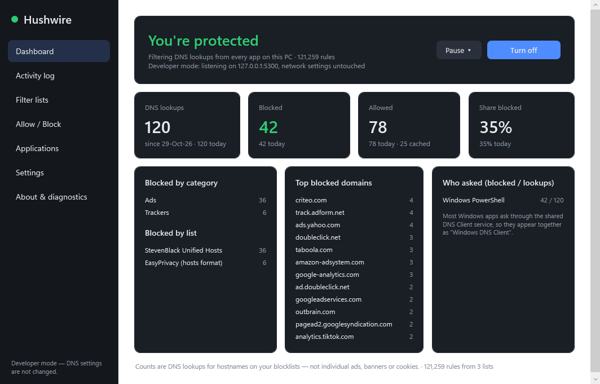
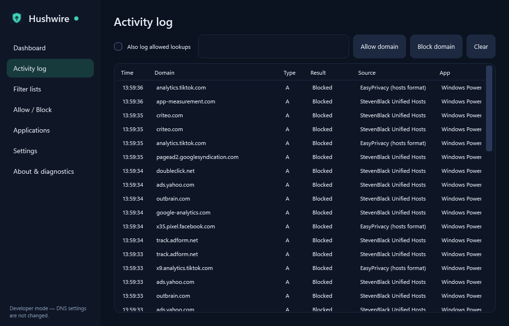
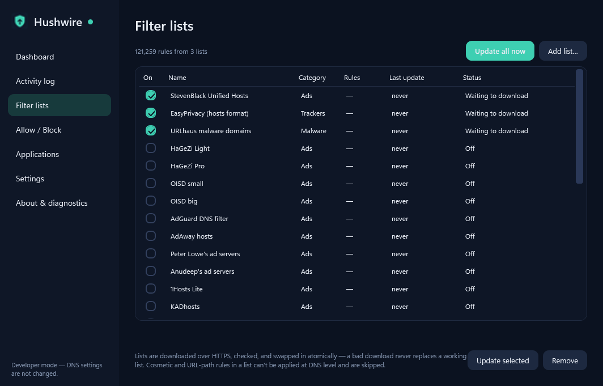
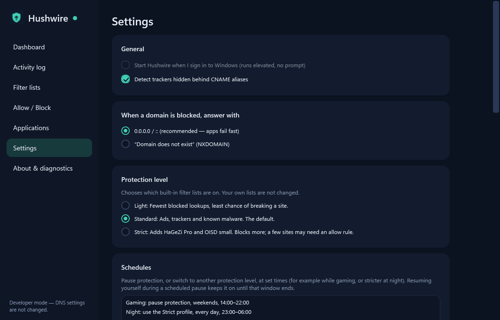
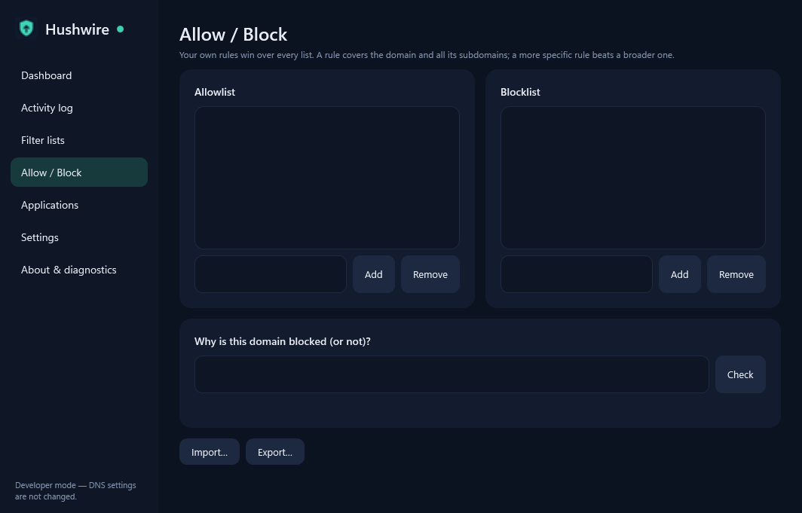

  

<h1 align="center">Hushwire</h1>

  <b>Quiet the noise on your whole PC.</b> 
  System-wide ad, tracker and malware blocking for Windows. No extension, no account, no data collected.

  
  
  
  

  <a href="#download">Download</a> ·
  <a href="#features">Features</a> ·
  <a href="#screenshots">Screenshots</a> ·
  <a href="#getting-started">Getting started</a> ·
  <a href="#faq">FAQ</a> ·
  <a href="docs/GUIDE.md">Guide</a>

  

Hushwire is a small Windows app that blocks ads, trackers and known-bad sites for **every program on your PC**: browsers, launchers, games and apps. It does this by
answering their DNS lookups itself. It lives in the tray, uses about as much CPU as a clock, and switches off with one click.

> **Early release (v0.1).** It runs daily on the author's PC, but the installer is not code-signed yet, so Windows SmartScreen may warn on first run. See [Verifying downloads](#verifying-downloads).

## Privacy first

|  |  |
|---|---|
| **No private data collected** | Hushwire does not collect, store or send your personal data. The settings, counters and activity log it keeps never leave your PC. |
| **No account** | Nothing to sign up for, nothing to log in to. |
| **No telemetry, no cloud** | The only connections it makes are DNS to your own DNS server (or the encrypted DNS server you choose, if you turn that on) and downloads of the filter lists you enabled. |
| **Open source** | GPL-3.0. Read it, build it, check it. |

## Features

| | |
|---|---|
| **Whole-PC blocking** | A local DNS filter covers every app, not just one browser. Blocked names fail instantly. |
| **28 filter lists** | StevenBlack, EasyPrivacy and URLhaus on by default; HaGeZi, OISD, AdAway, Disconnect, phishing and malware lists one click away. Add your own `https://` lists. |
| **Games stay working** | Steam, Riot, Epic, Battle.net, EA, Ubisoft, Rockstar, Xbox and anti-cheat services are never blocked. |
| **Your rules win** | Personal allow and block lists beat every list. A "why is this blocked?" check shows the exact rule. |
| **Hidden trackers** | CNAME-cloaking detection catches trackers disguised as a site's own subdomain. |
| **Dashboard** | Lookups and blocks (today and all time), by category and list, top domains, and which app asked. |
| **Something broke?** | One button lists the blocked lookups most likely to blame, ranked, and allows one for an hour. The allow switches itself off again. |
| **Self-check** | A plain "Protected / Partly protected / Not protected" status that tests blocking, your adapters and your upstream, and tells you when it changes. |
| **Levels and schedules** | Light, Standard or Strict, and rules such as "pause while gaming" or "strict at night". |
| **Fails safe** | Your DNS settings are restored on turn-off, exit, crash and reboot. Windows Update and other system domains can't be blocked. |
| **Light and fast** | About 0.5 ms extra per lookup, about 0.1 % of one core when idle, about 160 MB with over a million rules. |
| **Secure DNS (optional)** | Stop browsers from bypassing the filter with their own encrypted DNS, and send your lookups to an encrypted DNS-over-HTTPS server (Cloudflare, Quad9 or Google) with automatic fallback. |
| **YouTube & Twitch (optional)** | An opt-in, local in-page ad filter. Off by default. |

## Screenshots

| | |
|---|---|
|  |  |
| **Activity log**: every blocked lookup, the rule that caught it, and one-click allow or block | **Filter lists**: built-in lists, your own lists, safe automatic updates |
|  |  |
| **Settings**: protection level, schedules, secure DNS and notifications | **Allow / Block**: your own rules beat every list, plus a "why is this blocked?" check |

*Captured in developer mode with sample lookups, so the numbers are small.*

## Download

Windows 10 (2004+) or 11, 64-bit. Get the files from the [latest release](https://github.com/gbogdev/Hushwire/releases/latest).

| | Size | Notes |
|---|---|---|
| **Hushwire-Setup.msi** | 0.3 MB | Installer. Needs the free [.NET 9 Desktop Runtime](https://dotnet.microsoft.com/download/dotnet/9.0). |
| **Hushwire-Setup-standalone.msi** | 53 MB | Installer with its own runtime, for a PC without .NET 9. |
| **Hushwire-Portable.exe** | 0.6 MB | No installer. Needs the .NET 9 Desktop Runtime. |
| **Hushwire-Portable-standalone.exe** | 163 MB | No installer, carries its own runtime. |

Check the download against `SHA256SUMS.txt` on the release page.

## Getting started

1. **Install** (or run the portable exe). A short first-run guide helps you choose a level and turn it on. Windows asks for administrator rights, because Hushwire needs them to listen on port 53 and change adapter DNS.
2. Click **Turn on**. The first time, it downloads the default lists and points your network adapters at itself.
3. Open **About & diagnostics → Run checks**. Green ticks mean it is listening, your adapter uses it, normal sites resolve and a known ad domain is blocked.

Closing the window sends Hushwire to the tray and protection keeps running. **Exit** in the tray menu turns protection off and restores your DNS.
To remove it, use **Windows Settings → Apps**. That restores DNS and deletes everything Hushwire added.

<b>What Hushwire changes on your PC</b>

| Change | Where | When |
|---|---|---|
| Adapter DNS servers → `127.0.0.1` / `::1` | Physical Ethernet and Wi-Fi adapters only (VPN and virtual adapters are left alone) | While protection is on; originals are saved and restored |
| Settings, lists and a copy of your original DNS settings | `%ProgramData%\Hushwire` | Always |
| Scheduled tasks `HushwireRecover` (boot-time safety net) and `HushwireApp` (start at sign-in, optional) | Task Scheduler | While protection is on / if enabled |
| A private certificate authority | `LocalMachine\Root` | **Only** if you turn on the YouTube/Twitch filter |

Nothing else is touched: no firewall rules, proxy settings, hosts file or drivers. The portable exes copy themselves to `C:\Program Files\Hushwire` once protection is on, so the
administrator-level scheduled tasks never run a file a normal user can change.

## FAQ

<b>Does it store or send my browsing data?</b>

No. Hushwire keeps local counters and an activity log of blocked lookups so the dashboard works. They stay in `%ProgramData%\Hushwire` (administrators only) and you can clear them any time. Nothing is uploaded, and there is no account.

<b>Will it block every ad?</b>

No. DNS filtering can't remove ads served from the same hostname as the content (most of YouTube, many news sites), hide empty ad frames, or touch cookies. The dashboard counts **blocked DNS lookups, not ads or cookies**.
The optional YouTube/Twitch filter covers those two sites, and it is experimental.

<b>Why do some ads still show in my browser?</b>

Browsers with their own "Secure DNS" / DNS over HTTPS setting, apps with hard-coded DNS servers, and a VPN's DNS bypass any system DNS filter. Turn on **Settings → Secure DNS** to tell browsers in their default mode to keep using Hushwire (a browser forced into strict mode will show an error instead, so turn it off if that happens). **About & diagnostics** shows which adapters are covered.

<b>Will it break Windows, games or launchers?</b>

Windows Update, Defender, SmartScreen and connectivity checks are protected and can't be blocked by any list. Game launchers and anti-cheat services are protected too. If something still breaks, the activity log shows which domain was blocked, and one click allows it.

<b>What if Hushwire crashes?</b>

Your original DNS settings are saved before anything changes and restored on turn-off, exit, crash (a watchdog process) and reboot (a boot-time task). The Start-menu shortcut **Hushwire – repair network settings** works even if the app itself is broken.

<b>What does the "Something broke?" button do?</b>

It looks at what was blocked in the last 10 minutes and ranks it: recent blocks first, and blocks asked for by the program you were just using ranked highest. You can allow one for an hour (it switches itself off, even after a restart) or permanently, or pause protection for 5 minutes to find out whether Hushwire is the cause at all.

<b>How do I uninstall by hand?</b>

If you ran the plain exe instead of the installer:

1. In Hushwire, use **Settings → Turn off and remove the certificate** (only if you used the YouTube/Twitch filter), then tray → **Exit**.
2. Check DNS is back: `Get-DnsClientServerAddress` should show your normal servers, not `127.0.0.1`. If not, run `Hushwire.exe --restore`.
3. In an administrator PowerShell: `Unregister-ScheduledTask -TaskName HushwireRecover,HushwireApp -Confirm:$false`
4. Delete `%ProgramFiles%\Hushwire`, `%ProgramData%\Hushwire` and the folder you ran Hushwire from.

## Learn more

- **[Guide](docs/GUIDE.md)**: how it works, filter lists, the YouTube/Twitch filter, privacy and safety, building from source, status.
- **[Performance](docs/PERFORMANCE.md)**: measurements, method and how to reproduce them.
- **[Security policy](SECURITY.md)** · **[Third-party notices](THIRD_PARTY_NOTICES.md)**

## Verifying downloads

Releases are not code-signed, so SmartScreen may warn when you run the installer. Installers are built from source by a [GitHub Actions workflow](.github/workflows/build.yml); compare the SHA-256 on the release page with your download.

## License

Hushwire is free software under the **[GNU General Public License v3.0](LICENSE)**. Copyright (C) 2026 gbogdev. Third-party components and filter lists keep their own licenses.

Some features were built with the help of AI tools. Hushwire is provided as is: review it and test it before you rely on it.
